# radarwow-verify

**radar-wow: Verification.** Matching radar estimates to references (MRMS, gauges), scores stratified by range and hour.

Part of [radar-wow](https://github.com/manmeet3591/radar-wow), a set of repos that together build a radar QPE system that works for S, C and X band radars.
Every algorithm is one class implementing one paper, with the same interface: it takes an xradar sweep or volume with canonical moment names, declares the bands and moments it needs, and records provenance.

## Sub-components

| sub-component | algorithm | source | DOI | status |
|---|---|---|---|---|
| MRMS reference from AWS | `fetch_mrms` | Zhang et al. 2016, BAMS (MRMS) | [doi:10.1175/BAMS-D-14-00174.1](https://doi.org/10.1175/BAMS-D-14-00174.1) | implemented + notebook |
| polar-to-grid matching | `gate_latlon`, `to_mrms_grid` | 4/3-Earth beam geometry, cell averaging |  | implemented + notebook |
| model freezing level | `hrrr_freezing_level` | HRRR analysis on AWS (byte-range GRIB2) |  | implemented + notebook |
| continuous scores | `scores` | bias ratio, RMSE, correlation, MAE |  | implemented + notebook |
| hourly gauges (HADS via IEM) + QC | `fetch_hads`, `basic_qc` | Qi et al. 2016 (MRMS gauge QC, in spirit) | [doi:10.1175/JHM-D-15-0188.1](https://doi.org/10.1175/JHM-D-15-0188.1) | implemented + notebook |
| neighbourhood / categorical scores | - | use the `scores` library and pysteps (survey/04) |  | planned |

## Install

```bash
pip install git+https://github.com/manmeet3591/radarwow-core git+https://github.com/manmeet3591/radarwow-verify
```

## Notebooks (free data, S / C / X band)

- [`notebooks/01_ktlx_20220505_vs_mrms.ipynb`](notebooks/01_ktlx_20220505_vs_mrms.ipynb): open in Colab via `https://colab.research.google.com/github/manmeet3591/radarwow-verify/blob/main/notebooks/01_ktlx_20220505_vs_mrms.ipynb`
- [`notebooks/02_ktlx_20220505_vpr.ipynb`](notebooks/02_ktlx_20220505_vpr.ipynb): open in Colab via `https://colab.research.google.com/github/manmeet3591/radarwow-verify/blob/main/notebooks/02_ktlx_20220505_vpr.ipynb`
- [`notebooks/03_ktlx_20220505_advection.ipynb`](notebooks/03_ktlx_20220505_advection.ipynb): open in Colab via `https://colab.research.google.com/github/manmeet3591/radarwow-verify/blob/main/notebooks/03_ktlx_20220505_advection.ipynb`
- [`notebooks/04_kdax_20211024_blockage.ipynb`](notebooks/04_kdax_20211024_blockage.ipynb): open in Colab via `https://colab.research.google.com/github/manmeet3591/radarwow-verify/blob/main/notebooks/04_kdax_20211024_blockage.ipynb`
- [`notebooks/05_adaptive_alpha.ipynb`](notebooks/05_adaptive_alpha.ipynb): open in Colab via `https://colab.research.google.com/github/manmeet3591/radarwow-verify/blob/main/notebooks/05_adaptive_alpha.ipynb`

## Results

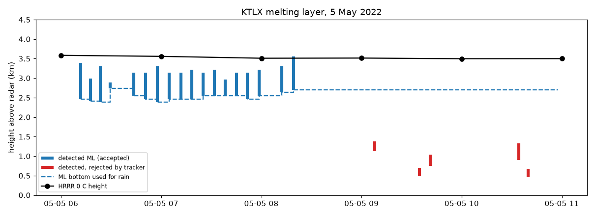
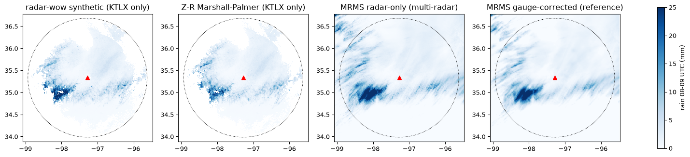
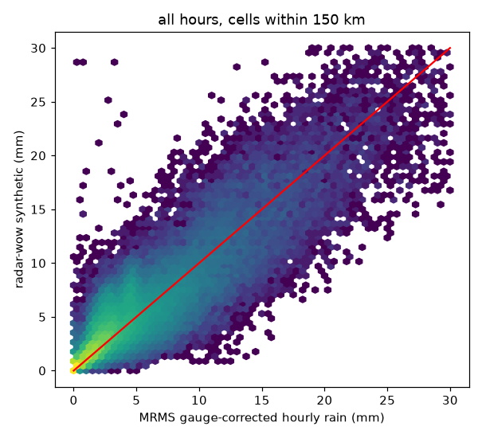
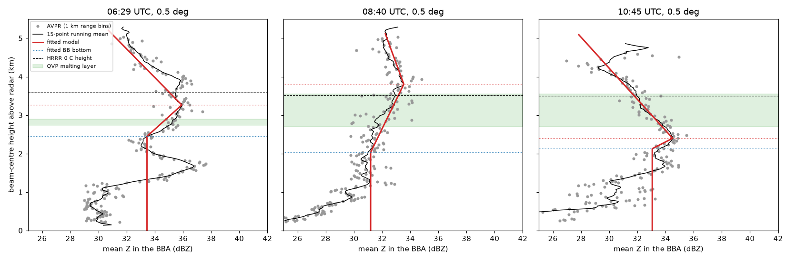
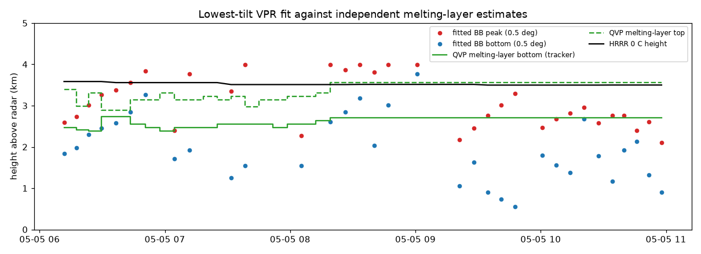
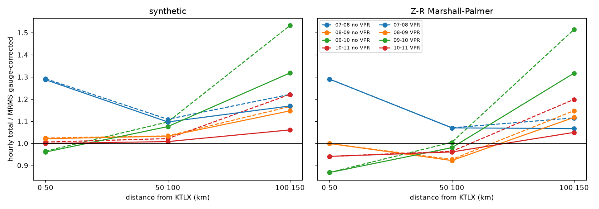
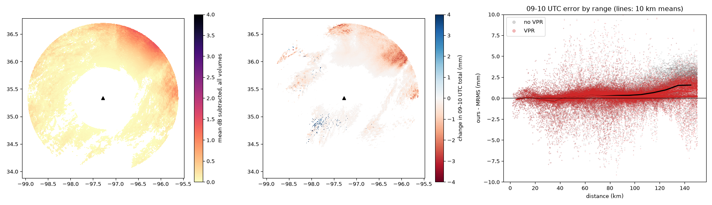
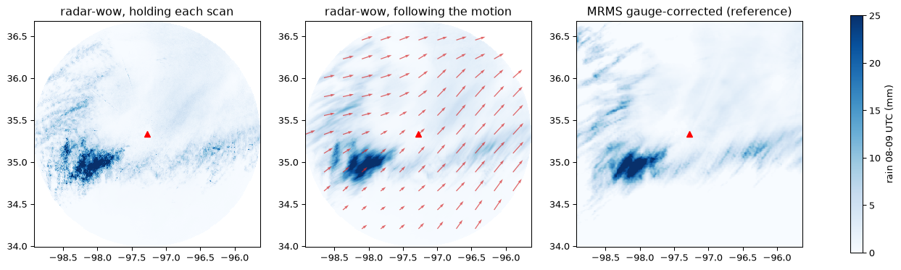
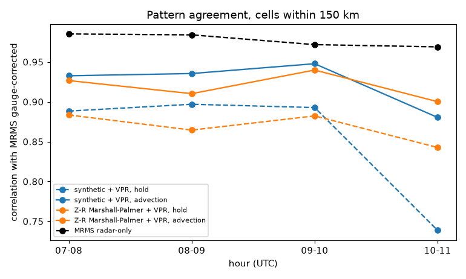
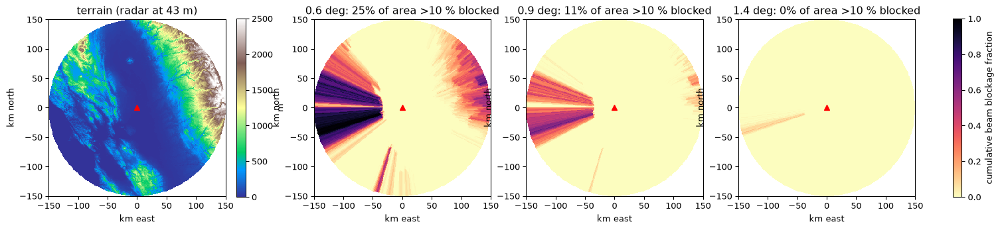
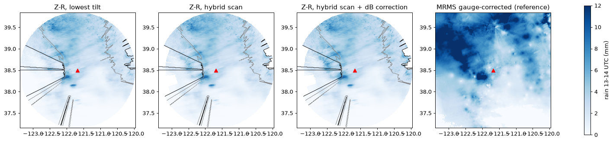
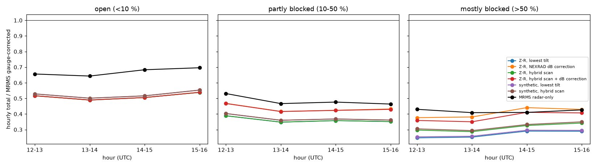
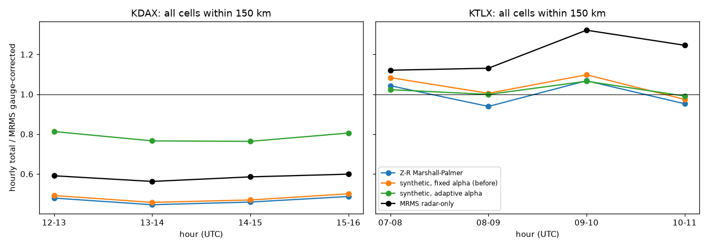
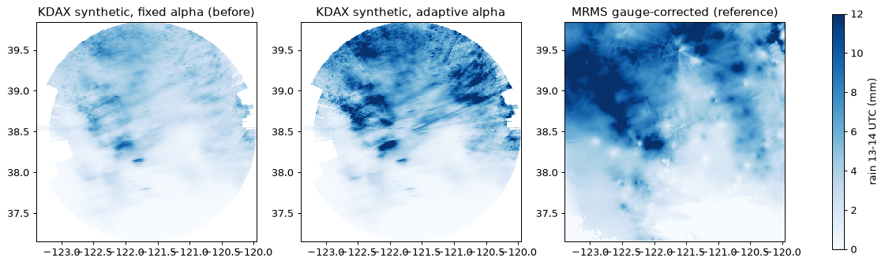

## Usage

```python
from radarwow.core import load_sample
from radarwow.verify import *  # see table above

vol = load_sample('arm_csapr2_c')        # or open_volume('my_file')
# out = SomeAlgorithm()(vol)            # band read from the file, or band='S'|'C'|'X'
```

## Status legend

*implemented + notebook*: code, tests, executed notebook. *planned*: interface fixed, code to write. *stub*: class exists, raises `NotImplementedError`. *to review*: paper to read before deciding.

## License

MIT. Data used in the notebooks comes from public archives (NEXRAD on AWS, ARM, IMD via open-radar-data) under their own terms.
